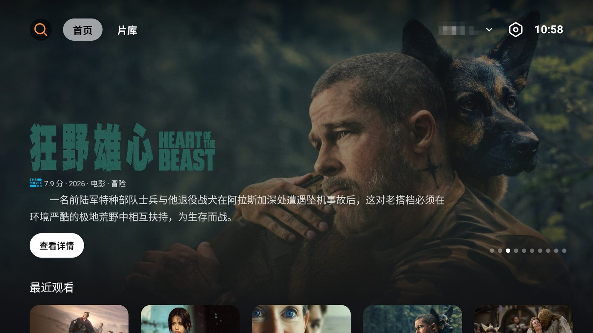
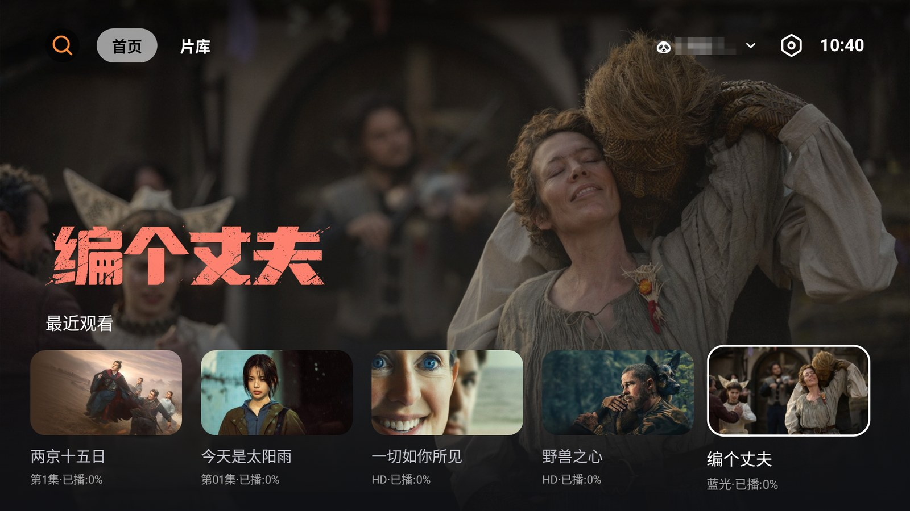
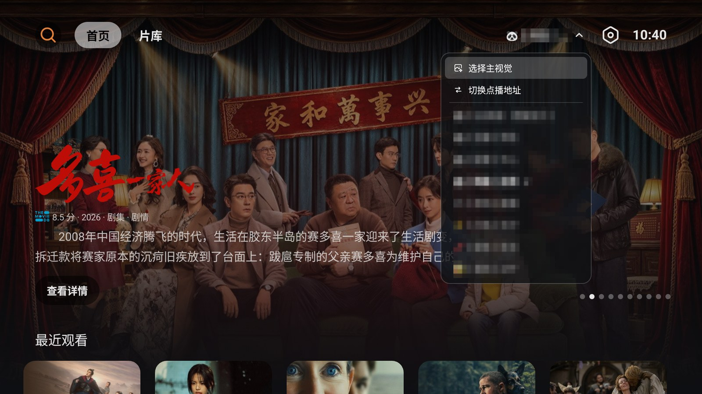
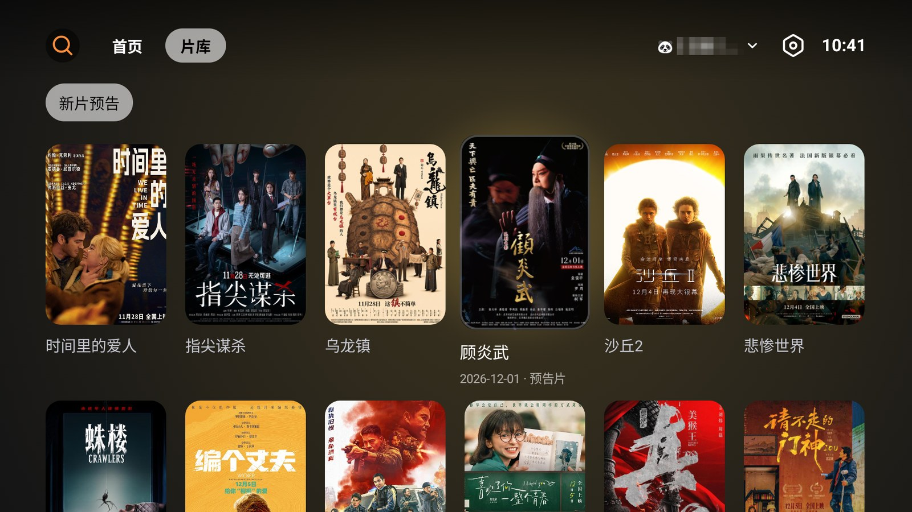

# NewTV2

专注 **Android TV** 的影视点播客户端，基于 [FongMi/TV](https://github.com/FongMi/TV) 5.8.7 深度定制：重写首页主视觉与共享顶栏，重构片库、详情、播放与搜索，只保留遥控器场景真正需要的能力。

  

  
  
  
  

**交流群组**：[Telegram · newtv_2](https://t.me/newtv_2)　｜　**下载**：[最新版本](https://github.com/ctowl2018/NewTV2/releases/latest)
## Star History

<a href="https://www.star-history.com/?repos=ctowl2018%2Fnewtv2&type=date&legend=top-left">
 <picture>
   <source media="(prefers-color-scheme: dark)" srcset="https://api.star-history.com/chart?repos=ctowl2018/newtv2&type=date&theme=dark&legend=top-left" />
   <source media="(prefers-color-scheme: light)" srcset="https://api.star-history.com/chart?repos=ctowl2018/newtv2&type=date&legend=top-left" />
   
 </picture>
</a>

> **声明**：本应用不含、不集成、不提供、不存储任何影视资源；界面中的海报、剧照等素材仅用于信息展示。详见文末[免责声明](#免责声明)。

## 目录

- [特性总览](#特性总览)
- [首页主视觉](#首页主视觉)
- [站点推荐](#站点推荐)
- [顶栏与站源](#顶栏与站源)
- [最近观看](#最近观看)
- [片库](#片库)
- [海报卡片](#海报卡片)
- [播放器](#播放器)
- [搜索与详情](#搜索与详情)
- [遥控器焦点](#遥控器焦点)
- [与上游的差异](#与上游的差异)
- [构建与发布](#构建与发布)
- [致谢](#致谢)
- [免责声明](#免责声明)

## 特性总览

| 模块 | 这一版的变化 |
| --- | --- |
| 首页 | 主视觉支持两种数据源：热榜聚合与站点推荐；横版剧照轮播 + 元数据面板 |
| 站点推荐 | 选一个站点解析其首页推荐，逐条匹配横版剧照，预览确认后才替换主视觉 |
| 顶栏 | 首页 / 片库双胶囊 + 搜索 + 站源面板 + 设置 + 时钟，单行紧凑、滚动自动显隐 |
| 站源 | 面板顶部固定「选择主视觉」「切换点播地址」，站点就地切换不重建页面 |
| 最近观看 | 从其它页面返回自动卷回首列；只有播放记录真的更新时才点亮第一条 |
| 片库 | 分类胶囊 + 三段式海报卡，确认键切页，站源切换不打断浏览位置 |
| 播放 | 单一播放引擎；弹幕热力图、弹幕搜索、片头片尾跳过 |
| 搜索 | 聚合热搜 + 双平台联想词；搜索历史只记主动搜索 |
| 详情 | TMDB 元数据与中文 Logo 自动补全，多结果优先精确匹配 |
| 发布 | 自动构建；双架构；原版与共存版两套安装包 |

## 最近观看

- **返回**：从设置、搜索、片库或播放页回到首页时，这一行自动卷回最左边，焦点落在第一条记录上。
- **选中**：只有从这一行进入播放、并且播放记录确实更新了，回来时才会把第一条点亮为选中态；普通返回只移动焦点，不留白框。
- **卡片**：横版剧照 + 片名 + 进度，聚焦时保留一圈呼吸白框，不参与整页光效。

## 站点推荐

把主视觉交给某个站点：入口在站源面板的「选择主视觉」里，选中「站点推荐」后选择要绑定的数据源。

- **只列可用的站点**：逐站实发一次首页请求，解析不出影片列表的不出现在列表里；探测过程带进度，焦点行会给出片名预览。
- **解析**：取该站首页推荐的前 10 部，逐条匹配 TMDB 横版剧照；结果面板给出「匹配 N / 共 M 部」与每一条的状态，未匹配的标红。
- **先预览、后应用**：解析结果只用于预览，点「应用」才替换当前主视觉；点「取消」或按返回，正在使用的主视觉与缓存都不受影响。
- **按点播地址记忆**：换到另一份点播地址时会记住上次绑定的站点；没有记忆时弹一次选择面板。
- **12 小时缓存**：到期后台静默重解析，成功后才替换画面；绑定的站点确实不在当前配置里时，才会提示重新绑定。
- **只取元数据**：主视觉只保存剧照地址等元数据，不额外下载、不生成缩略图，展示层按当前连接方式实时加载。

## 顶栏与站源

首页与片库共用同一套顶栏，一处调整两页同步生效：

- **左侧**：搜索圆钮 + 首页 / 片库两个导航胶囊。
- **右侧**：站源入口、设置图标、时钟。
- **站源面板**：顶部两个固定入口——「选择主视觉」与「切换点播地址」，下方是站点列表，当前站点加粗并标记；面板宽度与入口按钮对齐，带展开动画。
- **切页**：左右键只移动焦点，按确认键才切页；片库在站点配置就绪后才出现在顶栏，避免点进一个还没准备好的页面。
- **自动显隐**：内容区下滑时顶栏隐藏，回到顶部或焦点上移时重新出现。
- **返回**：焦点在设置、站源入口或搜索上时，按返回先回到本页的导航胶囊；站源面板展开时，返回先收起面板。

## 片库

- **分类胶囊**：分类由当前站点提供，胶囊横排、首屏全部可见。
- **站源切换**：在当前页就地完成，不闪烁、不重建页面，也不打断浏览位置。
- **切页方式**：仅顶部分类胶囊支持左右切换；焦点进入海报网格后，方向键只在网格内移动。
- **返回逻辑**：返回键先回到分类胶囊，向下可回到原来的海报位置。
- **尺寸联动**：在设置里调整海报尺寸后返回，片库按新尺寸自动刷新，无需重新进入。

## 海报卡片

首页 / 片库 / 收藏 / 历史 / 搜索结果共用同一套海报组件（适配深色 + 橙色点缀）：

- **结构**：海报图 → 片名独立行 → 元数据行，三段式垂直排列；片名与角标不再压在海报图上。
- **尺寸**：按屏幕安全区与列数自适应，整行恰好落在左右基线内。小 / 中 / 大 / 特大 四档对应 7 / 6 / 5 / 4 列，默认「中」= 6 列。
- **选中态**：聚焦时以白色描边勾出海报边界（不框住文字），并轻微放大，过渡柔和。
- **片名**：单行显示、尾部省略，默认浅灰、聚焦变白；仅当文字过长被截断时才滚动展示。

## 播放器

- **单一播放引擎**：只保留一套播放内核，含解码器预热等加载优化，包体更小、维护面更窄。
- **弹幕**：进度条叠加弹幕热力图，全片密度一目了然；弹幕搜索按片名 / 集数换源匹配；样式、速度、屏蔽可单独调整。
- **片头 / 片尾快捷跳过**：控制栏直接操作，到点即触发。
- **控制栏**：整体对齐重排，遥控器焦点走位顺畅一致。

## 搜索与详情

- **聚合热搜**：三组热搜榜与首页主视觉共用同一数据源，12 小时缓存，过期自动强刷。
- **联想词**：两个平台并发联想，过期结果按序丢弃、自动去重后展示。
- **搜索历史**：仅在搜索页主动搜索时写入；经「查看详情」直达结果页的关键词不会污染历史。
- **详情页**：TMDB 评分 / 年份 / 类型 / 题材 / 简介自动补全，多结果时优先精确匹配片名；片名优先使用中文 Logo 原图；底部剧照背景已停用，信息行更紧凑。

## 遥控器焦点

- **首帧**：启动后焦点落在顶栏「首页」，向下才进入内容区。
- **换行**：分类模块上下换行时保持同一列，不会每次都跳回最左边那张。
- **返回分层**：面板 → 内容区 → 顶栏本页胶囊 → 滚动回顶 → 退出，逐层回退，不会一步退出。
- **方向键**：左右只走位、确认才执行，避免横向移动时误触切页。

## 与上游的差异

| 移除项 | 说明 |
| --- | --- |
| 直播 | 整个直播体系移除，只保留点播 |
| 第二播放内核 | 统一单一播放引擎，减少包体与维护面 |
| 壁纸 / 双字幕 | 功能裁剪 |
| mobile 形态 | 代码保留但不再编译适配，仅维护 TV 形态 |

产物仅提供 `arm64-v8a` 与 `armeabi-v7a` 两种架构的 TV 版本。

## 构建与发布

- **自动构建**：推送主分支即自动编译并发布，无需本地打包。
- **双架构产物**：每次发布同时提供 64 位与 32 位安装包，覆盖主流电视芯片。
- **两套安装包**：原版包名保持 `com.fongmi.android.tv`；共存版使用独立包名，可与原版同时安装，适合一台电视同时保留两套配置。
- **版本号**：`<上游版本>.NewTV2.<日期>.<时间>`（北京时间），便于区分构建批次。
- **更新通道**：应用内检查更新直接读取本项目发布页，安装包命名与更新逻辑保持一致。

## 致谢

- 上游项目：[FongMi/TV](https://github.com/FongMi/TV) —— 本仓库所有基础能力（浏览、播放、投屏、互通、爬虫生态）均源于此。
- 爬虫开发参考：[CatVodSpider](https://github.com/FongMi/CatVodSpider)（Java / Python / QuickJS 示例）。
- 影视元数据：[TMDB](https://www.themoviedb.org/)。

> 本项目仅供学习交流，请勿用于商业用途。

## 免责声明

1. **不含任何影视资源**：本项目（下称"本应用"）是一款开源播放器客户端。本应用本身**不包含、不集成、不提供、不存储、不分发任何影视资源**（包括但不限于电影、电视剧、综艺、动漫等视频文件、音频、字幕，以及其直链、种子或下载地址）。

2. **内容来自用户自行配置的第三方接口**：本应用中呈现的一切可播放内容，均来自使用者自行添加的第三方站点接口（爬虫规则）所返回的数据，其合法性、准确性、完整性均与本应用无关。使用者应自行确保其配置与使用行为符合所在地区法律法规，由此产生的一切法律责任由使用者自行承担。

3. **展示素材仅作信息介绍**：应用界面中展示的海报、剧照、片名 Logo 等图片素材，来自公开的影视资料接口（如 TMDB），**仅用于内容识别与信息介绍，不涉及任何影视资源的存储、分发或播放**；相关素材的著作权归其原始权利人所有。

4. **仅供学习交流**：本项目仅供个人学习、研究与技术交流使用，严禁用于任何商业用途。

5. **侵权请联系删除**：若本项目（包括文档、截图及界面中展示的素材）侵害了您的合法权益，请通过 [GitHub Issues](https://github.com/ctowl2018/NewTV2/issues) 联系我们并提供权属证明，经核实后我们将立即删除相关内容。

6. **责任限制**：本项目按"现状"提供，不对内容的合法性、准确性、完整性作任何明示或默示的保证。下载、安装或使用本项目即视为已阅读、理解并同意本声明全部条款。
